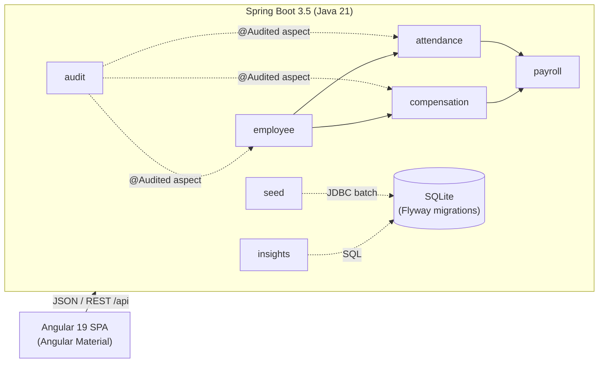

# Architecture and trade-offs

## Overview

The backend is **organized by feature** (`employee`, `compensation`, `attendance`, `payroll`,
`insights`, `seed`), not by layer. Each feature holds its own entity, repository, service and
controller, and other features use only its service. A new feature (for example leave balances or
a payroll run) is a new package, not changes spread across shared layers.

| Package | Responsibility |
|---|---|
| `employee` | Directory: profile, active status, search, reporting hierarchy and its rules. Publishes `EmployeeProfileChanged`. |
| `compensation` | Effective-dated pay components, eligibility (`CompensationPolicy`), history. |
| `attendance` | Monthly leave per `LeaveType`, working-day calendar, payroll cutoff. |
| `audit` | `@Audited` + `AuditAspect`: append-only change log (what, before → after, when, who, via which operation). |
| `payroll` | Pure `PayrollCalculator` + `TaxPolicy`; `PayrollService` builds a month's estimate. |
| `insights` | Read-only aggregate SQL (headcount, min/median/avg/max/total pay). |
| `meta` | Enum reference data for the UI, so values are defined once, in Java. |
| `seed` | Deterministic 10k-employee generator and JDBC batch loader. |

## Design patterns, and what each makes easy to extend

| Pattern | Where | What it makes easy |
|---|---|---|
| **Aspect-oriented programming** | `@Audited` + `AuditAspect` + per-feature `AuditSnapshot`s | Auditing is cross-cutting: services contain no audit code. To audit a new thing, add an `AuditSubject`, a snapshot bean and the annotation. |
| **Strategy, composed into a rule set** | `ReportingRule` beans → `ReportingPolicy` | New reporting rule (e.g. "same country", "max 15 direct reports") = one new `@Component`. The same rule both **validates** and **filters the manager picker**, so rules are never duplicated in the UI. |
| **Strategy** | `TaxPolicy`, `WorkingDayCalendar`, `CurrentActor` | Per-country tax slabs, holiday calendars, SSO user: swap one implementation. |
| **Enums that carry behaviour** | `PayType.isReducedByLossOfPay`, `LeaveType.isPaid` | New leave pool (e.g. `EARNED`, `PARENTAL`) or pay type = one constant. Storage, validation, pay maths and the UI form follow from it, with no `if (type == …)` scattered around. |
| **Domain events (observer)** | `EmployeeProfileChanged` → compensation | Modules react to each other without depending on each other. |
| **Dependency inversion** | `EmployeePayLookup` (defined in `employee`, implemented in `compensation`) | No package cycles, and modules can be split out later. |
| **Specification** | `EmployeeSpecifications`, `ReportingRule.candidateFilter` | New search filters compose without new repository methods. |
| **Effective dating (temporal data)** | `salary_component.effective_from/to` | Full pay history; back-dated or future-dated changes later need no schema change. |
| **Functional core, imperative shell** | `PayrollCalculator`, `CompensationPolicy`, `SeedDataGenerator` are pure | Rules are unit-tested in milliseconds; services only coordinate I/O. |
| **Data-driven UI** | `GET /api/meta` (departments, leave types, pay types…) | Adding an enum value shows up in the UI without a frontend change. |

### Worked extension examples
- **Add an "Earned leave" pool:** add `EARNED(true)` to `LeaveType`. Done: it's stored as a `monthly_leave` row, appears in the leave form via `/api/meta`, is excluded from loss of pay because it's paid, and is audited by the leave snapshot.
- **"Sales people may only report to Sales *managers*" (a title-based rule):** add a `ReportingRule` bean checking the manager's role, with a `candidateFilter`. Validation, the manager picker and error messages all pick it up.
- **Audit who approved leave:** add an `@Audited` approve operation. With SSO, swap `CurrentActor` to read the authenticated user.

## Key decisions

### Pay as effective-dated components, not a single `salary` column
`salary_component(employee_id, pay_type, amount, currency, effective_from, effective_to)`.
- **History is built in:** a revision closes the current row and opens a new one. Anyone can see what someone earned and when it changed.
- **Pay types are open for extension:** a new allowance is a new `PayType` constant and a rule in `CompensationPolicy`. No schema change.
- A **partial unique index** (`WHERE effective_to IS NULL`) lets the database itself guarantee at most one current amount per pay type.

### Rules live in small, pure classes
`PayrollCalculator`, `CompensationPolicy`, `WeekdayCalendar` and `SeedDataGenerator` do no I/O,
so the business rules are unit-tested in milliseconds. Services only coordinate.
Behaviour that differs by pay type is a property of the enum (`PayType.isReducedByLossOfPay`),
not an `if` repeated in several places.

### Extension points instead of speculative features
- `TaxPolicy`: flat 5% today; per-country slabs later.
- `WorkingDayCalendar`: Mon–Fri today; per-country holiday calendars later.
- `EmployeePayLookup`: lets the directory show monthly pay without `employee` depending on `compensation` (dependency inversion, no package cycle).
- `EmployeeProfileChanged` event: compensation reacts to department, type or country changes without the employee module knowing about pay.

### Reporting hierarchy as an adjacency list
`employee.manager_id` references `employee.id`. A single nullable column is enough for one solid line
per person. The management chain is walked in Java because depth is small: the seeded org is at most
4 levels deep. Loop detection walks up from the proposed manager. The hierarchy stays valid over time
because the team guard (H5) runs before profile or status changes take effect.

### Audit through AOP
`AuditAspect` runs around `@Audited` use-case methods:
1. Snapshot each listed subject.
2. Run the method.
3. Snapshot again and store only the fields that changed.

The aspect runs the whole thing in one transaction (`TransactionTemplate`), so a change and its audit
record commit or roll back together. The aspect is generic. Each feature exposes its own state through
an `AuditSnapshot`, which the aspect diffs, so it never knows about pay or leave.

**Trade-offs:**
- Two extra reads per audited call. That's negligible for HR edit volumes.
- Spring AOP proxies don't intercept calls a class makes to its own methods, so `@Audited` goes on the outermost operation. That's intended: one HR action gives one set of records.

### Leave as rows per leave type
`monthly_leave(employee_id, month, leave_type, days)` replaced one column per leave type (migration
V3 moves existing data). A new leave pool is no longer a schema change.

### Analytics in SQL, split by currency
Insights are single SQL queries with CTEs and window functions (true median via `ROW_NUMBER`).
The app never loads 10k rows into memory to compute a statistic. The `groupBy` dimension is an
enum mapped to a whitelisted column, so a request can't inject SQL into the query.
Amounts are never added across currencies (see ASSUMPTIONS I2).

### SQLite
It needs no setup and runs as a single file, which suits the requirement and the data size.
It is configured with WAL (readers don't block on writes), `busy_timeout`, and foreign keys on.
Flyway owns the schema (`ddl-auto: none`). Moving to Postgres means changing the driver and
dialect. The SQL uses only standard CTEs and window functions.

### API
- REST, resource-oriented. Pay, attendance and estimates sit under `/api/employees/{id}/…`.
- Errors are RFC 9457 `ProblemDetail`: 400 for malformed input or validation (with a field → message map), 404 for an unknown employee, 422 for a business rule (e.g. "employee is inactive").
- Pages use a stable `PageResponse` shape. Page size is capped at 100.

| Method & path | Purpose |
|---|---|
| `GET /api/employees?query&department&country&employmentType&active&page&size&sort` | Search the directory |
| `POST /api/employees` · `GET/PUT /api/employees/{id}` | Create / read / update a profile |
| `PATCH /api/employees/{id}/status` | Activate / deactivate |
| `GET /api/employees/{id}/compensation` · `/history` | Current pay & allowed pay types · full history |
| `PUT/DELETE /api/employees/{id}/compensation/{payType}` | Revise / end a component |
| `GET/PUT /api/employees/{id}/attendance/{yyyy-MM}` | Read / record a month's leave |
| `GET /api/employees/{id}/pay-estimate?month=yyyy-MM` | Net pay estimate |
| `GET /api/employees/{id}/reporting` · `PUT …/manager` · `GET …/manager-candidates?query=` | Reporting line, change manager, valid managers |
| `GET /api/audit?employeeId=&subject=` | Audit trail, newest first |
| `GET /api/insights/headcount?groupBy=` · `/api/insights/pay?groupBy=&country=` | Org insights |
| `GET /api/meta` | Enum reference data for the UI |

## Performance

| Concern | Approach | Measured (10k employees, laptop) |
|---|---|---|
| Seeding | Pure generator + JDBC `batchUpdate` in one transaction (not row-by-row JPA with IDENTITY ids, which can't batch) | ~1.5 s |
| Directory page | Server-side paging and filtering, indexed filter columns; monthly pay for the page fetched in **one** grouped query (no N+1) | ~20–50 ms |
| Insights | One aggregate SQL query per request | ~20–90 ms |
| Current-pay lookups | Partial unique index on `(employee_id, pay_type) WHERE effective_to IS NULL` | — |

## Testing strategy

- **Unit tests** cover the pure rules: pay calculation (LOP, incentive exemption, rounding, tax), working days and cutoff, pay eligibility, employee codes, seed invariants.
- **API tests** run full-stack against a throwaway SQLite file (real Flyway schema, no mocks) with a **fixed clock** (2026-11-11), so dates and month maths are deterministic. Tables are emptied before each test.
- They cover the active/inactive scenarios end to end: no payout, no pay changes and no attendance for inactive employees, and payment resumes after reactivation.
- Reporting tests cover every rule, including loops, the team guard and the candidate filter. Audit tests check what is recorded, and that no-ops and rejected changes record nothing.
- The schema migrations were also run against a database created by the previous version, to confirm existing leave data moves to the new table.
