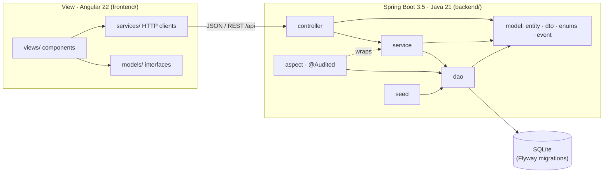

# Architecture and trade-offs

## Overview

The app follows **MVC with a layered backend**. Angular is the **View**, Spring REST controllers are
the **Controller**, and the **Model** is the `model` package, backed by the service and DAO layers.

### Backend layers (`backend/src/main/java/com/acme/hr`)

| Package | Layer | Contents |
|---|---|---|
| `controller` | Controller | REST endpoints only: bind and validate input, call **one service**, return DTOs. No logic, no entities, no DAOs. `ApiExceptionHandler` maps errors to problem responses. |
| `service` | Service | Business logic and transactions: `EmployeeService`, `EmployeeDirectoryService`, `ReportingService`, `CompensationService`, `AttendanceService`, `PayrollService`, `InsightsService`, `AuditService`, `MetaService`. |
| `service.policy` | Service | Business rules: `CompensationPolicy`, `ReportingPolicy` and the `ReportingRule` strategies. |
| `service.payroll` | Service | Pure pay maths: `PayrollCalculator`, `TaxPolicy`. |
| `service.calendar` | Service | `WorkingDayCalendar` (working days, payroll cutoff). |
| `service.audit` | Service | `AuditSnapshot` implementations: how profile, status, manager, pay and leave look to the audit. |
| `dao` | DAO | All queries and storage: Spring Data JPA repositories, `EmployeeSpecifications`, `InsightsDao` (aggregate SQL), `SeedDao` (bulk JDBC inserts). |
| `model.entity` | Model | JPA entities: `Employee`, `SalaryComponent`, `MonthlyLeave`, `AuditEntry`. |
| `model.dto` | Model | Request/response records (`EmployeeResponse`, `PayEstimate`, `ReportingView`, …) and value objects (`LeaveSummary`, `EmployeeProfile`). |
| `model.enums` | Model | `Department`, `Country`, `EmploymentType`, `PayType`, `LeaveType`, `Dimension`, `AuditSubject`. |
| `model.event` | Model | Domain events (`EmployeeProfileChanged`). |
| `aspect` | Cross-cutting | `@Audited`, `AuditAspect`, and the `AuditSnapshot` / `CurrentActor` extension points. |
| `config`, `exception`, `util`, `seed` | Support | App config and properties; `BusinessRuleException` / `ResourceNotFoundException`; `Money`, `EmployeeCode`; the 10k-employee seeder. |

**The layering is enforced, not just a convention.** `LayeredArchitectureTest` (ArchUnit) fails the
build if:
- a controller uses a DAO or an entity;
- anything other than a controller calls a service;
- anything other than a service, the aspect or the seeder calls a DAO;
- the model depends on any layer above it;
- there is any package cycle.

### View layer (`frontend/src/app`)

| Folder | Contents |
|---|---|
| `models/` | TypeScript interfaces mirroring `model.dto`, one file per area (`employee.model.ts`, `payroll.model.ts`, …). |
| `services/` | One HTTP service per backend controller (`EmployeeService` → `EmployeeController`, `PayrollService` → `PayrollController`, …), `MetaService` (reference data) and the error interceptor. |
| `views/` | Screens and their components: `employees/` (list, detail, reporting, pay, estimate and activity panels) and `insights/`. Components call services, never `HttpClient` directly. |
| `shared/` | Formatting pipes and small helpers. |

## Design patterns, and what each makes easy to extend

| Pattern | Where | What it makes easy |
|---|---|---|
| **Layered MVC** | `controller` → `service` → `dao`, `model` shared; Angular as the View | Each change has an obvious home, and ArchUnit stops shortcuts that would tangle the layers. |
| **Aspect-oriented programming** | `@Audited` + `AuditAspect` + `AuditSnapshot`s in `service.audit` | Auditing is cross-cutting: services contain no audit code. To audit a new thing, add an `AuditSubject`, a snapshot bean and the annotation. |
| **Strategy, composed into a rule set** | `ReportingRule` beans → `ReportingPolicy` | New reporting rule (e.g. "same country", "max 15 direct reports") = one new `@Component`. The same rule both **validates** and **filters the manager picker**, so rules are never duplicated in the UI. |
| **Strategy** | `TaxPolicy`, `WorkingDayCalendar`, `CurrentActor` | Per-country tax slabs, holiday calendars, SSO user: swap one implementation. |
| **Enums that carry behaviour** | `PayType.isReducedByLossOfPay`, `LeaveType.isPaid` | New leave pool (e.g. `EARNED`, `PARENTAL`) or pay type = one constant. Storage, validation, pay maths and the UI form follow from it, with no `if (type == …)` scattered around. |
| **Domain events (observer)** | `EmployeeProfileChanged` → `CompensationService` | Services react to a change without the publisher depending on them (`EmployeeService` doesn't know about pay). |
| **Facade** | `EmployeeDirectoryService` | Combines profile and pay for the UI so controllers only deal in DTOs. |
| **Specification** | `dao.EmployeeSpecifications`, `ReportingRule.candidateFilter` | New search filters compose without new repository methods. |
| **Effective dating (temporal data)** | `salary_component.effective_from/to` | Full pay history; back-dated or future-dated changes later need no schema change. |
| **Functional core, imperative shell** | `PayrollCalculator`, `CompensationPolicy`, `SeedDataGenerator` are pure | Rules are unit-tested in milliseconds; services only coordinate I/O. |
| **Data-driven UI** | `GET /api/meta` (departments, leave types, pay types…) | Adding an enum value shows up in the UI without a frontend change. |

### Worked extension examples
- **Add an "Earned leave" pool:** add `EARNED(true)` to `LeaveType`. Done: it's stored as a `monthly_leave` row, appears in the leave form via `/api/meta`, is excluded from loss of pay because it's paid, and is audited by the leave snapshot.
- **"Sales people may only report to Sales *managers*" (a title-based rule):** add a `ReportingRule` bean checking the manager's role, with a `candidateFilter`. Validation, the manager picker and error messages all pick it up.
- **Audit who approved leave:** add an `@Audited` approve operation. With SSO, swap `CurrentActor` to read the authenticated user.

## Key decisions

### Pay as effective-dated components, not a single `salary` column
`salary_component(employee_id, pay_type, amount, currency, effective_from, effective_to)`.
- **History is built in:** a revision closes the current row and opens a new one. Anyone can see what someone earned and when it changed.
- **Pay types are open for extension:** a new allowance is a new `PayType` constant and a rule in `CompensationPolicy`. No schema change.
- A **partial unique index** (`WHERE effective_to IS NULL`) lets the database itself guarantee at most one current amount per pay type.

### Rules live in small, pure classes
`PayrollCalculator`, `CompensationPolicy`, `WeekdayCalendar` and `SeedDataGenerator` do no I/O,
so the business rules are unit-tested in milliseconds. Services only coordinate.
Behaviour that differs by pay type is a property of the enum (`PayType.isReducedByLossOfPay`),
not an `if` repeated in several places.

### Extension points instead of speculative features
- `TaxPolicy`: flat 5% today; per-country slabs later.
- `WorkingDayCalendar`: Mon–Fri today; per-country holiday calendars later.
- `ReportingRule`: one bean per reporting rule; it validates assignments and filters the manager picker.
- `AuditSnapshot` / `CurrentActor`: what gets audited, and who the actor is (SSO later).
- `EmployeeProfileChanged` event: `CompensationService` reacts to department, type or country changes without `EmployeeService` knowing about pay.

### Reporting hierarchy as an adjacency list
`employee.manager_id` references `employee.id`. A single nullable column is enough for one solid line
per person. The management chain is walked in Java because depth is small: the seeded org is at most
4 levels deep. Loop detection walks up from the proposed manager. The hierarchy stays valid over time
because the team guard (H5) runs before profile or status changes take effect.

### Audit through AOP
`AuditAspect` runs around `@Audited` use-case methods:
1. Snapshot each listed subject.
2. Run the method.
3. Snapshot again and store only the fields that changed.

The aspect runs the whole thing in one transaction (`TransactionTemplate`), so a change and its audit
record commit or roll back together. The aspect is generic. Each area exposes its own state through an
`AuditSnapshot` in `service.audit`, which the aspect diffs, so the aspect never knows about pay or leave.

**Trade-offs:**
- Two extra reads per audited call. That's negligible for HR edit volumes.
- Spring AOP proxies don't intercept calls a class makes to its own methods, so `@Audited` goes on the outermost operation. That's intended: one HR action gives one set of records.

### Leave as rows per leave type
`monthly_leave(employee_id, month, leave_type, days)` replaced one column per leave type (migration
V3 moves existing data). A new leave pool is no longer a schema change.

### Analytics in SQL, split by currency
Insights are single SQL queries with CTEs and window functions (true median via `ROW_NUMBER`).
The app never loads 10k rows into memory to compute a statistic. The `groupBy` dimension is an
enum mapped to a whitelisted column, so a request can't inject SQL into the query.
Amounts are never added across currencies (see ASSUMPTIONS I2).

### SQLite
It needs no setup and runs as a single file, which suits the requirement and the data size.
It is configured with WAL (readers don't block on writes), `busy_timeout`, and foreign keys on.
Flyway owns the schema (`ddl-auto: none`). Moving to Postgres means changing the driver and
dialect. The SQL uses only standard CTEs and window functions.

### API
- REST, resource-oriented. Pay, attendance and estimates sit under `/api/employees/{id}/…`.
- Errors are RFC 9457 `ProblemDetail`: 400 for malformed input or validation (with a field → message map), 404 for an unknown employee, 422 for a business rule (e.g. "employee is inactive").
- Pages use a stable `PageResponse` shape. Page size is capped at 100.

| Method & path | Purpose |
|---|---|
| `GET /api/employees?query&department&country&employmentType&active&page&size&sort` | Search the directory |
| `POST /api/employees` · `GET/PUT /api/employees/{id}` | Create / read / update a profile |
| `PATCH /api/employees/{id}/status` | Activate / deactivate |
| `GET /api/employees/{id}/compensation` · `/history` | Current pay & allowed pay types · full history |
| `PUT/DELETE /api/employees/{id}/compensation/{payType}` | Revise / end a component |
| `GET/PUT /api/employees/{id}/attendance/{yyyy-MM}` | Read / record a month's leave |
| `GET /api/employees/{id}/pay-estimate?month=yyyy-MM` | Net pay estimate |
| `GET /api/employees/{id}/reporting` · `PUT …/manager` · `GET …/manager-candidates?query=` | Reporting line, change manager, valid managers |
| `GET /api/audit?employeeId=&subject=` | Audit trail, newest first |
| `GET /api/insights/headcount?groupBy=` · `/api/insights/pay?groupBy=&country=` | Org insights |
| `GET /api/meta` | Enum reference data for the UI |

## Performance

| Concern | Approach | Measured (10k employees, laptop) |
|---|---|---|
| Seeding | Pure generator + JDBC `batchUpdate` in one transaction (not row-by-row JPA with IDENTITY ids, which can't batch) | ~1.5 s |
| Directory page | Server-side paging and filtering, indexed filter columns; monthly pay for the page fetched in **one** grouped query (no N+1) | ~20–50 ms |
| Insights | One aggregate SQL query per request | ~20–90 ms |
| Current-pay lookups | Partial unique index on `(employee_id, pay_type) WHERE effective_to IS NULL` | — |

## Testing strategy

- **Unit tests** cover the pure rules: pay calculation (LOP, incentive exemption, rounding, tax), working days and cutoff, pay eligibility, employee codes, seed invariants.
- **API tests** run full-stack against a throwaway SQLite file (real Flyway schema, no mocks) with a **fixed clock** (2026-11-11), so dates and month maths are deterministic. Tables are emptied before each test.
- They cover the active/inactive scenarios end to end: no payout, no pay changes and no attendance for inactive employees, and payment resumes after reactivation.
- **Architecture tests** (ArchUnit) enforce the MVC layering and the absence of package cycles.
- Reporting tests cover every rule, including loops, the team guard and the candidate filter. Audit tests check what is recorded, and that no-ops and rejected changes record nothing.
- The schema migrations were also run against a database created by the previous version, to confirm existing leave data moves to the new table.

## Future scope: authentication and role-based access control (RBAC)

v1 assumes one trusted HR Manager and has no login. Before real use, the panel needs authentication
(who are you?) and RBAC (what may you see and change?). The design already has the places this
plugs into, so it adds to the layers rather than reshaping them.

### Authentication
- **Company SSO via OpenID Connect** (Okta, Microsoft Entra ID, Google Workspace). The app never stores passwords.
- **Recommended: Spring Boot as the backend-for-frontend (BFF).**
  - Spring Security's `oauth2Login` runs the authorization-code flow with PKCE.
  - The session is kept in an `HttpOnly`, `Secure`, `SameSite` cookie, with CSRF protection.
  - The Angular app never handles tokens. This suits our setup, where Spring already serves the SPA from the same origin.
- **Alternative:** Angular gets tokens itself (via an OIDC client library), and Spring validates the JWT as an `oauth2ResourceServer`. This is simpler if other clients will also call the API, but tokens then live in the browser.
- **Sessions:** short idle timeout and logout that also ends the IdP session. Login, logout and access-denied events go to the audit log.

### Roles and permissions

Roles are bundles of fine-grained **permissions**. Code checks permissions, never role names, so
roles can be reshaped without touching code.

| Role | Typical permissions |
|---|---|
| `HR_ADMIN` | Everything, including role assignment |
| `HR_MANAGER` | `EMPLOYEE_READ/WRITE`, `PAY_READ/WRITE`, `LEAVE_WRITE`, `MANAGER_ASSIGN`, `INSIGHTS_READ`, `AUDIT_READ`, within their scope (below) |
| `PAYROLL_OFFICER` | `PAY_READ`, `LEAVE_WRITE`, `PAYROLL_RUN` (future), with no profile edits |
| `PEOPLE_MANAGER` (line manager) | `EMPLOYEE_READ` and `LEAVE_WRITE` for their reporting tree; pay hidden or read-only by policy |
| `AUDITOR` | `AUDIT_READ`, `INSIGHTS_READ`, read-only everywhere |
| `EMPLOYEE` (self-service, later) | Own profile, pay and leave, read-only |

Permissions are checked in three ways:
- **Action level** (may you do X at all?): `@PreAuthorize("hasAuthority('PAY_WRITE')")`.
- **Data scope** (on whose records?):
  - HR by country or department (e.g. HR India sees only `IN` employees).
  - Line managers see only their reporting tree, via a recursive query on `manager_id`.
  - Employees see only themselves.
- **Field level:** for example, a line manager may see a report's profile but not their salary. That is a separate response DTO, or salary fields left out based on permission.

### How it fits the current layers

| Layer | Addition |
|---|---|
| `config` | `SecurityConfig`: the `SecurityFilterChain` (OIDC login or JWT), CSRF, and mapping the IdP's group claim to roles and permissions. |
| `model` / `dao` | `app_user(id, idp_subject, email, employee_id)` and `role_assignment(user_id, role, scope_type, scope_value)`, e.g. `HR_MANAGER` with scope `COUNTRY=IN`, plus a Flyway migration. Role and permission definitions can start as an enum and move to tables when admins need to edit them. |
| `service` | `@PreAuthorize` on **service** methods (not controllers), so every entry point is covered, including future jobs or queues. A new `AccessScopeService` turns the current user's scope into a JPA `Specification`, which is composed into every query (`EmployeeSpecifications`, insights SQL, audit search). This is the same pattern the reporting rules and search filters already use, so row-level security is one more filter, not scattered `if`s. |
| `aspect` | Replace `RequestHeaderActor` with a `SecurityContextActor` implementing the existing `CurrentActor` interface. The audit log then records the real authenticated user with no other change. Add audit records for access-denied events. |
| `controller` | Mostly unchanged. A new `GET /api/me` returns the user, roles and effective permissions for the UI. `ApiExceptionHandler` maps `AccessDeniedException` to 403. |
| View (Angular) | A route guard redirects to login when there's no session. `/api/me` drives a `*hasPermission` directive that hides or disables actions (Revise pay, Mark inactive, Change manager). The UI only hides things for convenience; the backend stays the source of truth. |

### Hardening that comes with it
- **Maker-checker for sensitive changes.** For example, a pay revision above a threshold, or a change to someone's own record, needs a second approver. This builds on the audit trail and would be a `PENDING` state on the change.
- **Separation of duties:** no one approves their own change or edits their own pay.
- **Rate limiting and lockout** come from the IdP. Security headers (CSP, HSTS) come from Spring Security.
- **Tests:**
  - `spring-security-test` (`@WithMockUser` / JWT post-processors) runs the API tests as each role.
  - An ArchUnit rule fails the build if a public service method that writes data has no `@PreAuthorize`.

### Rollout
1. Turn on SSO login, with every authenticated user as `HR_ADMIN`. Nothing changes functionally, but the audit log now records real users.
2. Add permissions and `@PreAuthorize` on services, then `/api/me` and UI gating.
3. Add data scopes (country/department for HR, reporting tree for line managers).
4. Add maker-checker approvals for pay changes.
